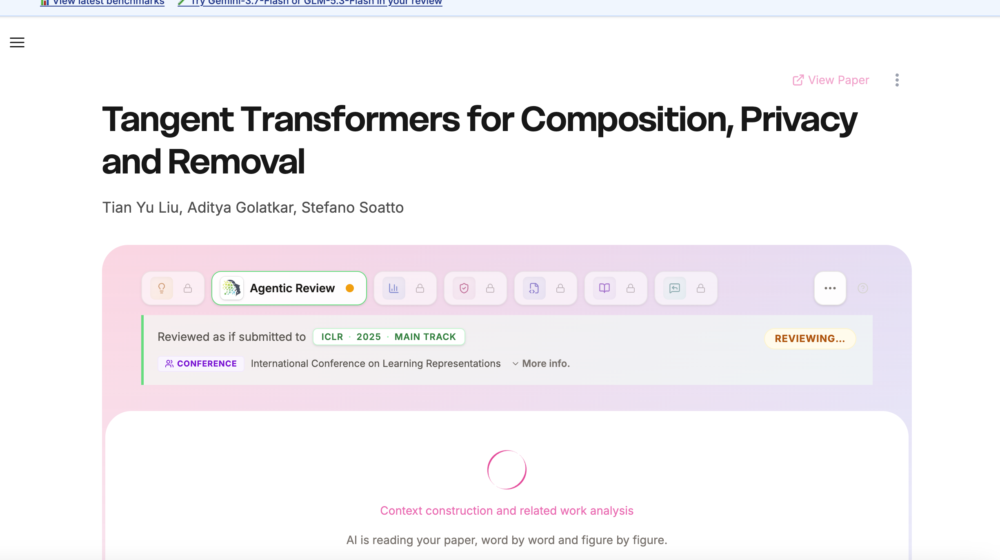

# CSPaper 前端参考与验收规范

> 范围提示（2026-09-20）：本页记录第一轮及 2026-09-14 旧第二轮稿的视觉参考。当前第二轮以[Paper Credibility Check 开发计划](../../00_项目总览/第二轮_可信度核查开发计划.md)为主，CSPaper 风格不再是本轮主要验收目标；以下图片或模块不构成新可信度功能需求。

本页把 2026 年 9 月 8 日保存的 CSPaper 原始截图和风格记录转为本项目可检查的前端要求。参考重点是论文阅读层级、工作区布局、导航与状态表达。截图中的其他工具模块仅为样式参考，不自动纳入 CS-2 功能范围。

## 参考图与对应用途

| 参考文件 | 主要观察内容 | 本项目对应场景 |
|---|---|---|
| [论文工作区](参考图/cspaper-paper-review-loading.png) | 大标题、作者层级、粉紫工作区和白色内容面板 | 报告页总体结构 |
| [分析进度](参考图/cspaper-agentic-review-progress.png) | 加载环、阶段说明、状态标识和留白 | 任务处理中 |
| [展开工具菜单](参考图/cspaper-tool-menu-expanded.png) | 图标、文字、选中、禁用及浮层 | 报告导航和更多操作 |
| [详情内容](参考图/cspaper-reference-check-details.png) | 清晰标题、说明文字和内容区 | 五维报告、证据及问题详情 |
| [展开模块标签](参考图/cspaper-module-tabs-expanded.png) | 紧凑与展开标签共存 | 不同窗口宽度下的导航 |

## 本轮页面检查要求

| 检查项 | 参考方向 | 本项目验收时检查什么 |
|---|---|---|
| 阅读层级 | 宽松留白、醒目论文标题、弱化作者信息 | 标题能换行，元信息与正文有层级，核心报告易找到 |
| 主工作区 | 粉色到淡紫的浅色背景、大圆角白色面板 | 主报告区域突出，装饰不妨碍文字阅读 |
| 内容组织 | 一个主要阅读区域、适量分隔 | 五维评分、理由、优缺点、总体判断、置信度和证据均可查看 |
| 导航 | 图标优先，当前模块可见文字和彩色边框 | 用户知道当前位置；图标有可理解名称，内容多时有收纳方式 |
| 任务状态 | 加载图形配阶段文字和状态标签 | 显示真实阶段；失败说明原因和下一步，不能无限等待 |
| 空值与不确定 | 明确区分不可用状态 | 无法评估或不适用不显示成 0 分；说明原因 |
| 证据查看 | 报告结论可进入相关详情 | 可以找到原文片段及页码或章节，不丢失证据关系 |
| 窄窗口 | 保留主阅读区，导航先收纳 | 无关键按钮遮挡、标题截断或整页横向溢出 |

这些是第二轮草拟的检查要求，具体页面改动由前端提出并纳入任务。首轮原型中已存在的布局可逐步调整，无需为贴合截图重新实现全部页面。

## 状态与交互细节

选中、键盘焦点、禁用和加载应能区分；状态不只靠颜色表达。参考图使用锁图标表示不可用工具，但本项目没有相应功能时不必复制一排锁定入口。悬停提示简短直接，关键动作不能只依赖鼠标悬停才能理解。

加载说明使用当前真实阶段，没有测量依据时不显示承诺性的完成时间。报告区中保留现有产品边界及不确定性说明；不复制参考产品的评分结论、模型宣传或会议年份作为本项目配置。

## 前端提交的验收材料

前端交付“页面或状态、对应参考图、改动说明、前后对照截图、实际版本、验证步骤和已知问题”。至少覆盖本轮改动的输入页、处理状态、报告页、证据查看和失败状态；历史结果页面仅在功能获准纳入后检查。

产品组将页面检查与功能流程合并到 [整体验收路径](../../03_过程与交付/验收与演示材料/第二轮_整体验收路径.md)，交曾博成审核。截图用于视觉检查，真实操作用于功能检查，两者都不能被“看起来像 CSPaper”一句话替代。

## 主参考图

其余原始图见本页上方表格，5 张图片均随包提供。它们是第三方产品参考截图，不代表本项目已经实现相同功能。
